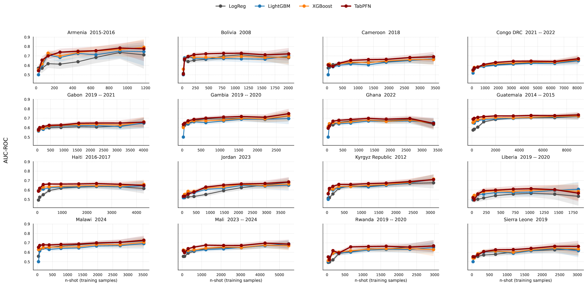
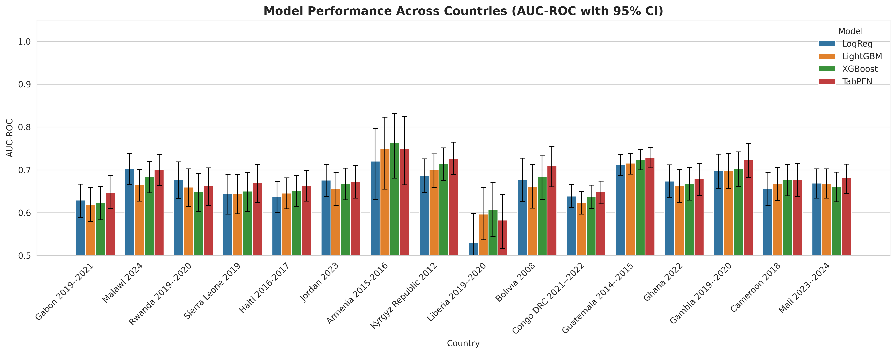
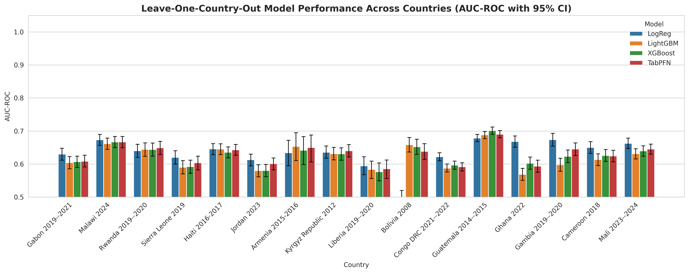
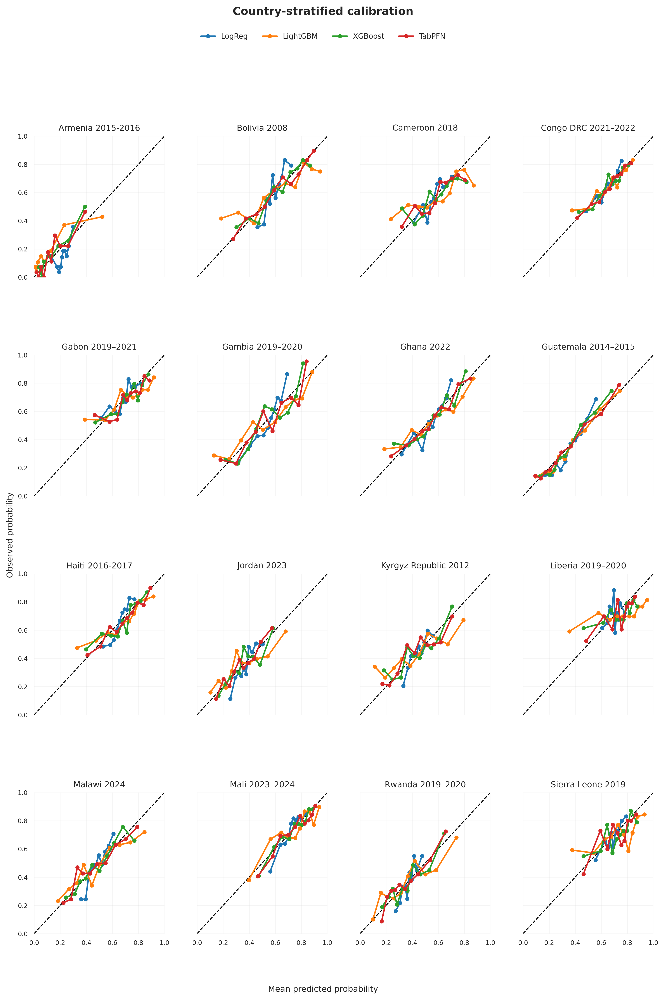
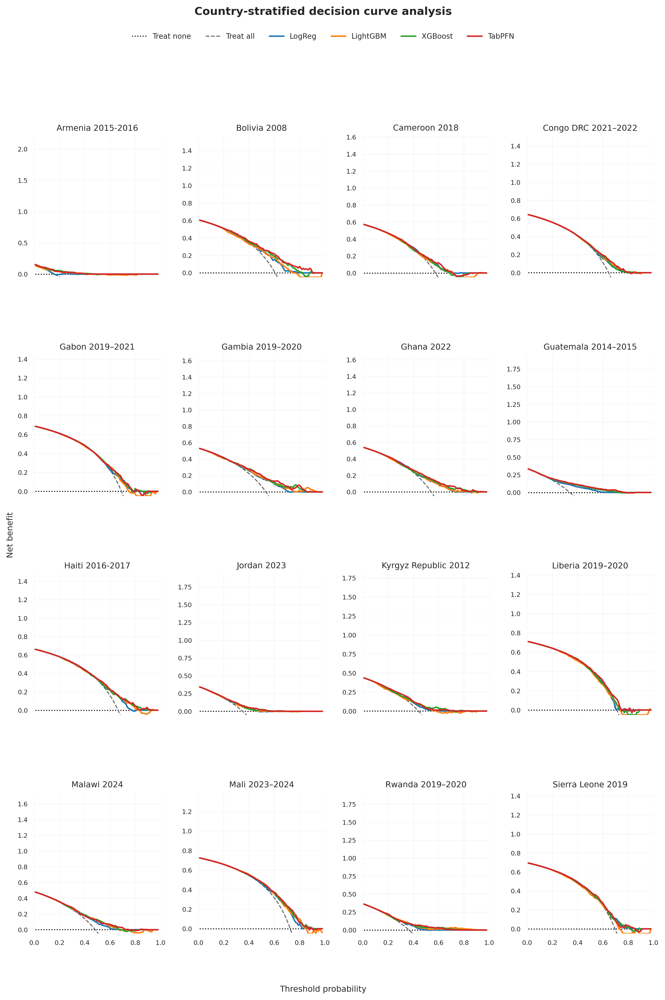

# Few-shot Cross-country Generalization of Tabular Machine Learning and Foundation Models for Childhood Anemia Prediction under Distribution Shift

Code accompanying the manuscript of the same title (Brima, Atemkeng, Kallon, Niyukuri, Vacavant, Saidu, Chen), submitted to *BioData Mining*.

We compare Logistic Regression, LightGBM, XGBoost, and the tabular foundation model TabPFN for predicting childhood anemia (children aged 6–59 months) from harmonized Demographic and Health Surveys (DHS) children's recode (KR) data from 16 countries, under within-country, leave-one-country-out (LOCO), reverse-LOCO, and few-shot evaluation, with calibration, subgroup, decision curve, and SHAP analyses.

## Key results

### Few-shot learning
With fewer than about 200 within-country training samples, TabPFN achieved higher AUC-ROC than the supervised models; the gap narrowed as labeled data accumulated.



### Within-country discrimination
AUC-ROC ranged from 0.53 to 0.76. Differences between countries were larger than differences between models; TabPFN's advantage was small but consistent across countries.



### Leave-one-country-out generalization
Performance declined modestly on unseen countries (AUC-ROC 0.57–0.70 for all but one country–model pair), and the target country mattered more than the choice of model.



### Calibration
With full within-country training data, TabPFN had the lowest mean Brier score (0.203) and expected calibration error (0.042).



### Decision curve analysis
All models provided positive net benefit over treat-none across a broad range of thresholds, with small differences between models.



### Feature importance (TabPFN)
Child age was the dominant predictor in most countries; the contribution of altitude, anthropometry, and household wealth varied across settings.


## Data

The DHS data are available from the [DHS Program](https://dhsprogram.com/Data/) upon registration and request. Under the DHS data use agreement they cannot be redistributed, so this repository contains **no microdata and no child-level outputs**. Only code and aggregate results (country-, model-, feature-, or subgroup-level) are included.

After obtaining the KR datasets for the 16 surveys listed in the manuscript (Table 1), set the data location before running any script:

```bash
export DHS_DATA_ROOT=/path/to/DHS_Databases   # folder holding the DHS KR datasets
export RESULTS_DIR=results                     # optional, default: results
export FIGURES_DIR=figures                     # optional, default: figures
```

## Installation

```bash
pip install -r requirements.txt
```

The analyses were run with Python 3.12 on a single NVIDIA A100 GPU. TabPFN is run locally (`tabpfn` package) with `ignore_pretraining_limits=True`, so that its in-context support set is always the full training partition given to the supervised models.

## Workflow

Run the scripts from the repository root, in this order.

| Step | Script | Produces |
|---|---|---|
| 1 | `extract.py` | Unzips the downloaded DHS archives |
| 2 | `harmonize.py` | Survey registry `dhs_country_file_summary.csv` (local paths, not tracked) |
| 3 | `merger.py` | Harmonized KR files |
| 4 | `constructor.py` | `results/dhs_country_data_summary.csv` |
| 5 | `flow_chart.py` | `results/exclusion_counts_*.csv` |
| 6 | `missing.py` | `results/missingness_*.csv` |
| 7 | `prevalence.py` | `results/country_anemia_prevalence.csv` |
| 8 | `hyperparam.py` | `results/best_hyperparameters.json` (Optuna, tuned once on 80% of the pooled data) |
| 9 | `anemia_ci.py` | `results/anemia_model_results_by_country*.csv` (stratified 80/20 split, BCa bootstrap CIs) |
| 10 | `anemia_ci_sensitivity.py` | `results/anemia_model_results_by_country_{mice,knn}.csv` |
| 11 | `calibration.py` | Calibration metrics and predictions for decision curves (child-level predictions stay local) |
| 12 | `few_shot_ci_robust.py` | `results/<country>_fewshot_results.csv` |
| 13 | `loco_ci.py` | `results/anemia_loco_results.csv` |
| 14 | `loco_reverse_ci.py` | `results/anemia_reverse_loco_results.csv` |
| 15 | `sub_group.py`, `sub_group_age.py` | `results/subgroup_analysis_optuna_models*.csv` (complete cases) |
| 16 | `sub_group_stat.py` | `results/supplementary_subgroup_table.csv` |
| 17 | `shap_analysis.py` | SHAP / shapiq feature attributions |
| 18 | `Visualize.ipynb` | Figures and statistical comparisons (paired Wilcoxon tests with Holm adjustment, country-level cluster bootstrap) |

`Cleaner.ipynb` contains additional figure-formatting code. Shared preprocessing (DHS missing codes, outcome definition, imputation fitted on the training partition, standardization) is in `util.py`, and the predictor list is in `config.py`. `confidenceinterval/` is a vendored copy of the bootstrap confidence-interval utilities used for all reported CIs.

## License

MIT License

Copyright (c) 2026 Yusuf Brima

Permission is hereby granted, free of charge, to any person obtaining a copy
of this software and associated documentation files (the "Software"), to deal
in the Software without restriction, including without limitation the rights
to use, copy, modify, merge, publish, distribute, sublicense, and/or sell
copies of the Software, and to permit persons to whom the Software is
furnished to do so, subject to the following conditions:

The above copyright notice and this permission notice shall be included in all
copies or substantial portions of the Software.

THE SOFTWARE IS PROVIDED "AS IS", WITHOUT WARRANTY OF ANY KIND, EXPRESS OR
IMPLIED, INCLUDING BUT NOT LIMITED TO THE WARRANTIES OF MERCHANTABILITY,
FITNESS FOR A PARTICULAR PURPOSE AND NONINFRINGEMENT. IN NO EVENT SHALL THE
AUTHORS OR COPYRIGHT HOLDERS BE LIABLE FOR ANY CLAIM, DAMAGES OR OTHER
LIABILITY, WHETHER IN AN ACTION OF CONTRACT, TORT OR OTHERWISE, ARISING FROM,
OUT OF OR IN CONNECTION WITH THE SOFTWARE OR THE USE OR OTHER DEALINGS IN THE
SOFTWARE.
